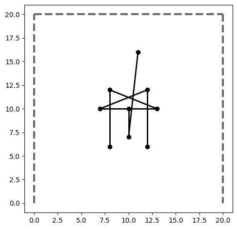
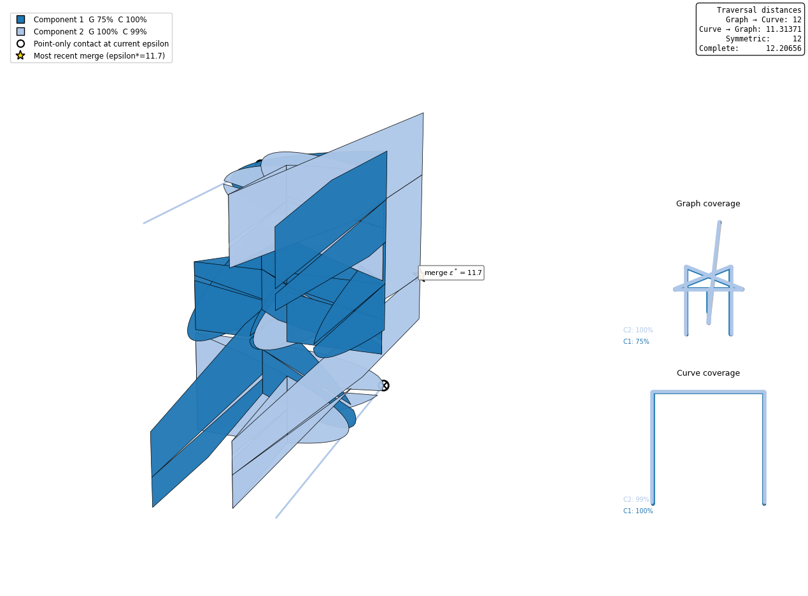
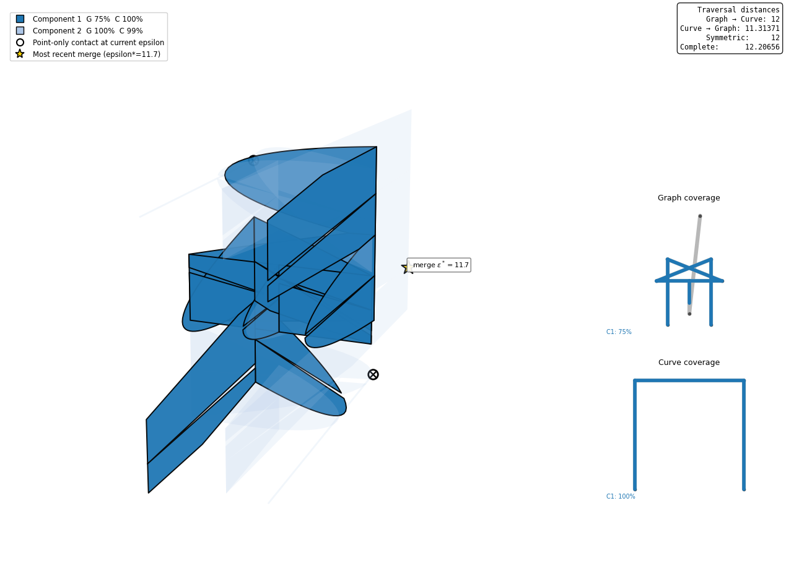
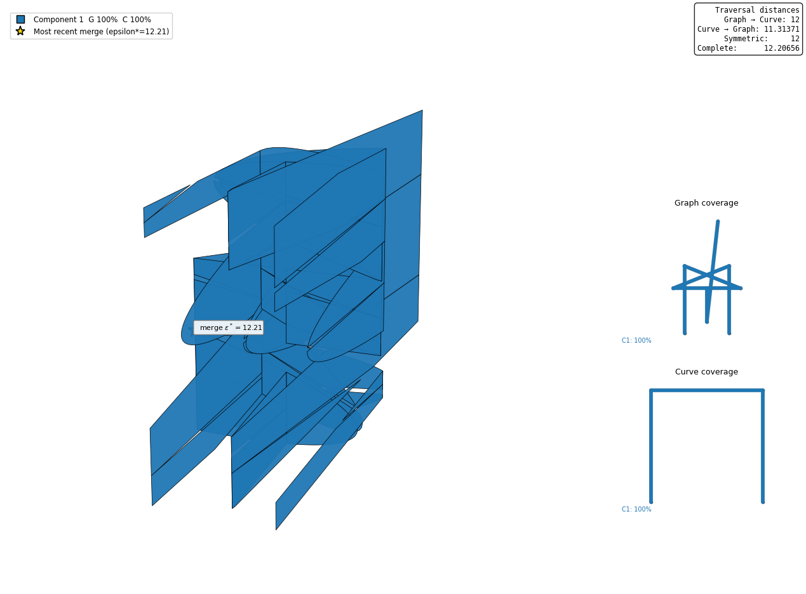
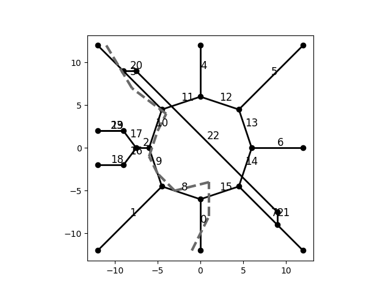
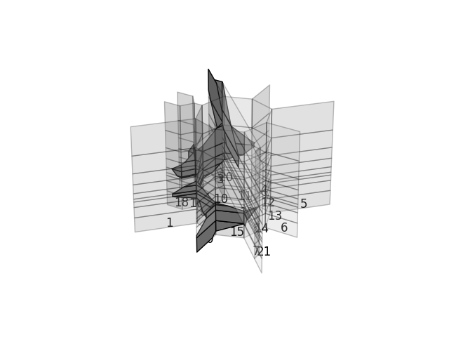
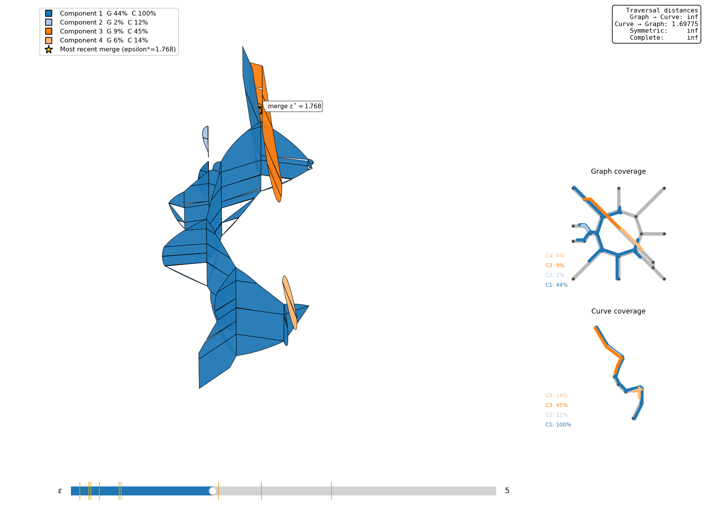
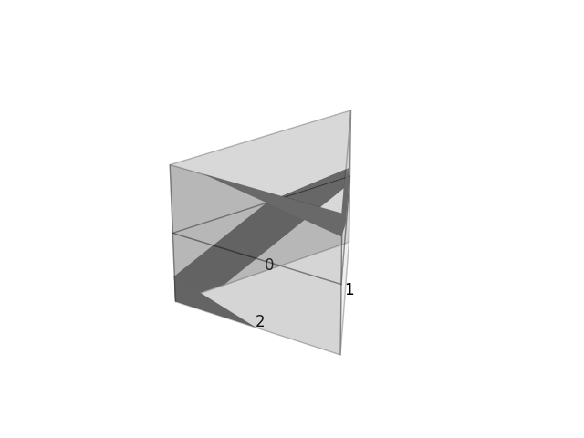
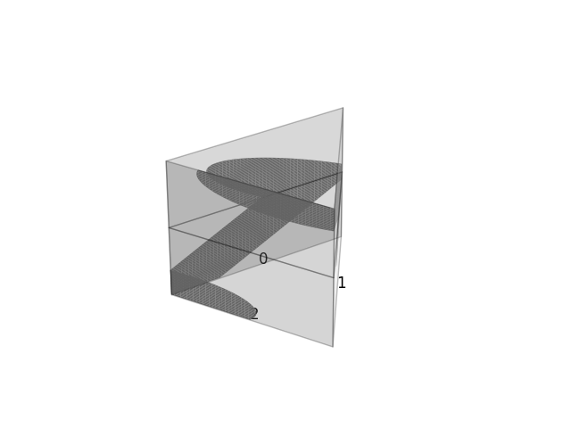
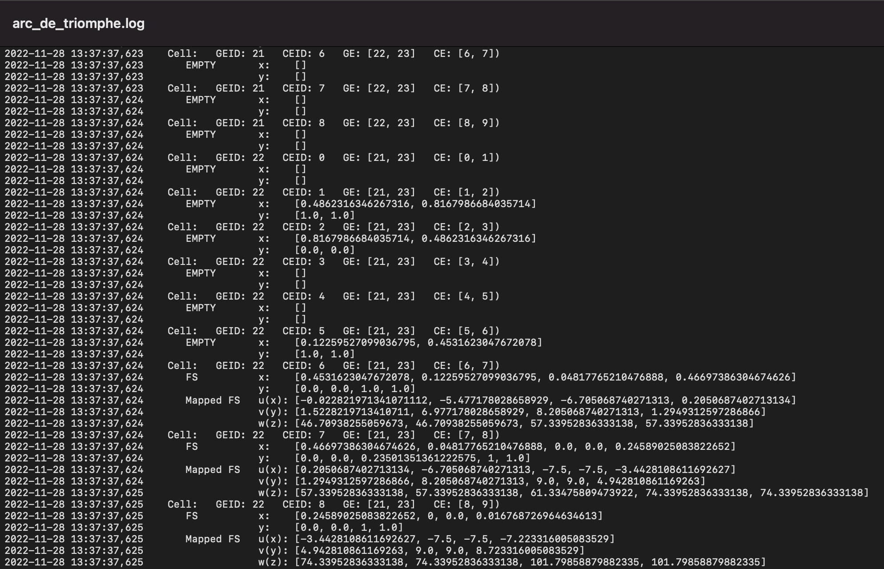

# FSDvis: Graph-by-Curve Free-Space Visualization

FSDvis visualizes the free space between a straight-line graph and a polygonal curve. The graph is drawn in the horizontal plane of a 3-D diagram, while height records arc length along the curve.

The repository provides three main capabilities:

- **Free-space visualization:** render the graph-by-curve free space, with different connected components shown in different colors.
- **Interactive exploration:** click a free-space component to isolate it and inspect exactly what it covers on the graph and curve, vary epsilon with a slider, and display point contacts and component-merger events.
- **Traversal-distance display:** when the companion [traversalDistance](https://github.com/compgeomTU/traversalDistance) package is installed, display the two directed traversal distances, their symmetric maximum, and the complete traversal distance.

The visualizer can also save static figures, plot the two inputs in 2-D, compute free-space area, highlight selected components, and write computation logs.

## Installation

Python 3.9 or later is required. FSDvis can be used by itself, or together with the companion [traversalDistance](https://github.com/compgeomTU/traversalDistance) repository to display the four traversal-distance values.

### FSDvis by itself

Clone FSDvis and install it in editable mode:

```bash
git clone https://github.com/compgeomTU/FSDvis.git
python3 -m pip install -e ./FSDvis
```

This installs the dependencies declared in `pyproject.toml` and makes the `fsdvis` command available. You can also run `python3 main.py ...` directly from inside the checkout.

### FSDvis with traversal-distance values

To have FSDvis compute and display traversal-distance values, install both repositories in the same Python environment:

```bash
git clone -b compute-all-distances https://github.com/compgeomTU/traversalDistance.git
git clone https://github.com/compgeomTU/FSDvis.git
python3 -m pip install -e ./traversalDistance
python3 -m pip install -e ./FSDvis
```

If you already have the repositories checked out, switch `traversalDistance` to the `compute-all-distances` branch, then run the two `pip install -e` commands using the paths to your checkouts. FSDvis will then display the traversal-distance values automatically.

The slider requires an interactive Matplotlib window. Static figures can be saved with `-f` / `--figure`.

## Quick start: U-path and immersed tree

A complete runnable example is provided in:

```text
examples/u_path_immersed_tree.py
```

It uses the committed sample inputs `samples/U_gap_H` and `samples/U_gap_P`, which are also used by the regression tests.

Run it from the repository root:

```bash
python3 examples/u_path_immersed_tree.py
```

To save the figure instead of opening an interactive window:

```bash
python3 examples/u_path_immersed_tree.py --output u_tree_eps12.png
```

The inputs are a U-shaped path `P` and an immersed tree `H`:



Geometric crossings of the tree are not graph vertices unless the input edges share a vertex ID there.

At epsilon 12, the free space has two connected components:



For this input order, **Graph = H** and **Curve = P**. The example prints:

```text
Traversal distances:
  Graph H -> Curve P: 12
  Curve P -> Graph H: 11.31371
  Symmetric:          12
  Complete:           12.20656
epsilon = 12
connected components = 2
  component 1: graph 75.37%  curve 100.00%
  component 2: graph 100.00%  curve 99.16%
```

One component covers the entire curve and a different component covers the entire graph. Thus both directed traversal conditions hold at epsilon 12, while no single component covers both inputs. This is why the symmetric distance is 12 but the complete distance is larger, approximately 12.20656.

In the interactive window, **click either colored free-space component** to select it. The other components fade, and the Graph coverage and Curve coverage panels show only the portions covered by the selected component. Click the selected component again, or press `Esc`, to return to the all-component view.

The same example with Component 1 selected looks like this:



At epsilon 12.3, the free space has one component covering both inputs:

```bash
python3 examples/u_path_immersed_tree.py --epsilon 12.3 --output u_tree_eps12_3.png
```



To explore the same example interactively with the epsilon slider:

```bash
python3 main.py samples/U_gap_H samples/U_gap_P \
    -e 12 --slider --epsilon-range 10.5 13 --no-cells --no-labels
```

The distance values depend only on the input pair. Moving the slider changes the displayed free space and its components, not the four distances. Component clicking continues to work while using the slider; when possible, the selected component is followed across epsilon changes by one of its product cells.

## Command line

The general form is:

```bash
python3 main.py GRAPH_PREFIX CURVE_PREFIX [options]
```

If FSDvis was installed with `python3 -m pip install -e .`, the equivalent command is:

```bash
fsdvis GRAPH_PREFIX CURVE_PREFIX [options]
```

### Main options

| Option | Meaning |
| --- | --- |
| `-e EPS`, `--epsilon EPS` | Free-space threshold; also the initial slider value. |
| `-a EPS`, `--area EPS` | Compute and print free-space area at the specified threshold. |
| `-n N`, `--approximation N` | Subdivide input edges for the approximation mode, with `N >= 2`. |
| `-f FILE`, `--figure FILE` | Save a static figure instead of displaying it. |
| `-l FILE`, `--log FILE` | Write computation information to a log file. |
| `-p`, `--plot-2d` | Plot the graph and curve in 2-D. |

### Interactive and display options

| Option | Meaning |
| --- | --- |
| `--slider`, `--epsilon-slider` | Show the epsilon slider; requires `-e`. |
| `--epsilon-range MIN MAX` | Set the slider range. |
| `--slider-step STEP` | Restrict slider movement to increments of `STEP`. |
| `--no-cells` | Hide the translucent product-cell surfaces. |
| `--no-labels` | Hide graph edge labels. |
| `--no-legend` | Hide the connected-component legend. |
| `--no-critical-contacts` | Hide point-contact and recent-merge markers. |
| `--no-coverage-inset` | Hide the graph and curve coverage views. |
| `--no-distances` | Skip traversal-distance computation and display. |
| `--distance-tolerance TOL` | Set the traversal-distance search tolerance; default `1e-6`. |
| `--graph-scale S` | Change the display scale of the graph plane. |
| `--curve-scale S` | Change the display scale of the curve arc-length direction. |
| `--equal-data-scale` | Use equal data-unit scaling in all three displayed directions. |
| `--highlight-component ID` | Emphasize one 1-based free-space component. |
| `--highlight-point X Y Z` | Emphasize the component containing a specified free-space point. |

The component and point highlighting options are mutually exclusive. Display scaling changes only the rendering, not the input geometry, epsilon, connectivity, coverage, or traversal distances. Camera orientation and zoom are retained while the slider changes epsilon.

`--slider` cannot be combined with `-f` because a saved figure is static.

To see all options:

```bash
python3 main.py --help
```

## Input format

Each input prefix identifies two comma-separated files without a header:

```text
NAME_vertices.txt    vertex_id,x,y
NAME_edges.txt       edge_id,start_vertex_id,end_vertex_id
```

Each listed edge is an undirected abstract graph edge. Endpoint order supplies a local parameterization but does not restrict traversal direction. A geometric crossing becomes a graph vertex only if the intersecting edges are split there and use a shared vertex ID.

For the curve input, vertices must be numbered `0, 1, ..., k` in curve order, with edges `0, 1, ..., k-1` joining consecutive vertices in that order. The second input is therefore a path rather than a branching graph or a cycle.

The repository includes these sample pairs:

| Graph prefix | Curve prefix |
| --- | --- |
| `samples/A` | `samples/B` |
| `samples/H` | `samples/G` |
| `samples/P` | `samples/Q` |
| `samples/arc_de_triomphe` | `samples/vehicle_path` |
| `samples/U_gap_H` | `samples/U_gap_P` |

## Arc de Triomphe example

The repository includes a simplified road network around the Arc de Triomphe in Paris together with a vehicle trajectory.


Plot the graph and vehicle path in 2-D:

```bash
python3 main.py samples/arc_de_triomphe samples/vehicle_path -p -f arc_inputs.png
```



The graph is black and the vehicle path is dashed gray.

Display the free space at epsilon 5:

```bash
python3 main.py samples/arc_de_triomphe samples/vehicle_path -e 5 -f arc_freespace.png
```



The component-colored visualizer can also show the same input with coverage views and the epsilon slider:

```bash
python3 main.py samples/arc_de_triomphe samples/vehicle_path \
    -e 5 --slider --epsilon-range 0 15 --no-cells --no-labels
```



At epsilon 5 this input has four connected free-space components. The same component colors are used in the 3-D free space and in the graph/curve coverage views.

The supplied Arc de Triomphe graph is disconnected as an abstract graph: vertices 20–23 form a separate component. Consequently, a continuous traversal cannot cover the entire graph. The distance panel therefore reports infinite Graph → Curve, symmetric, and complete distances for this stored input, while Curve → Graph is finite. The U-path/tree example above provides connected inputs with four finite distances.

## Connected components, coverage, and critical events

Every nonempty graph-edge × curve-edge cell is assigned to a connected free-space component. Components are colored consistently across the 3-D free space, the legend, and the two coverage views. In an interactive window, clicking a colored component selects it and restricts the coverage views to that component; click it again or press `Esc` to clear the selection.

Coverage is measured by length: covered graph-edge length divided by total graph-edge length, and covered curve arc length divided by total curve length. Different free-space components may project onto overlapping portions of an input, so component percentages need not sum to 100%.

A **white circle with a black ×** marks a feasible shared boundary that consists of a single point at the current epsilon. A **gold star** marks the most recent epsilon value at which the global number of connected components decreased. Gold ticks on the slider mark such component-merger thresholds.

A point-only contact does not necessarily merge two global components because the incident cells may already be connected elsewhere.

## Free-space geometry and area

For a graph edge `e` and curve segment `p`, the free space in the corresponding parameter cell is the set

$$
F_\varepsilon(e,p)
=\left\lbrace (u,v)\in[0,1]^2 : 
\lVert e(u)-p(v)\rVert_2\leq\varepsilon \right\rbrace.
$$

FSDvis detects nonempty cell free space, including regions lying entirely in the interior of a cell, and connects cells through feasible shared boundaries. Curved cell boundaries are rendered by a polygonal approximation for display.

Print the free-space area at epsilon 5 with:

```bash
python3 main.py samples/P samples/Q -a 5
```

Area is measured in graph-edge-length × curve-arc-length units.

### Subdivision / approximation gallery

The `-n` option subdivides graph and curve edges before constructing the diagram. The repository includes the following comparison figures.

Without subdivision:



With `-n 5`:

```bash
python3 main.py samples/P samples/Q -e 5 -n 5
```


With `-n 50`:

```bash
python3 main.py samples/P samples/Q -e 5 -n 50
```



## Logging

Write computation information to a log file with `-l`:

```bash
python3 main.py samples/arc_de_triomphe samples/vehicle_path \
    -e 5 -l arc_de_triomphe.log
```

An example log is shown below:



## Traversal-distance support

When the [traversalDistance](https://github.com/compgeomTU/traversalDistance) package is installed, FSDvis displays:

- Graph → Curve directed traversal distance
- Curve → Graph directed traversal distance
- symmetric traversal distance
- complete traversal distance

For definitions and the distance-computation API, see the traversalDistance repository. FSDvis passes its graph and curve directly to that package; `--distance-tolerance` controls the epsilon-search tolerance used for the displayed values.

## Tests

Run the regression tests from the repository root:

```bash
python3 -m pytest -q
```

The U-path/tree tests use the same committed inputs as `examples/u_path_immersed_tree.py`. Core visualization tests run without the optional traversal-distance package; the distance-value test runs when that package is installed.

## Author and contributors

**Author:** Will Rodman, Tulane University · [wrodman@tulane.edu](mailto:wrodman@tulane.edu)

| Contributor | Contact / website |
| --- | --- |
| Dr. Carola Wenk | [cwenk@tulane.edu](mailto:cwenk@tulane.edu) · [Website](https://www.cs.tulane.edu/~carola/) |
| Erfan Hosseini Sereshgi | [shosseinisereshgi@tulane.edu](mailto:shosseinisereshgi@tulane.edu) · [Website](https://erfanhosseini.com) |
| Emily Powers | [epowers3@tulane.edu](mailto:epowers3@tulane.edu) |
| Rena Repenning | [Website](http://renarepenning.com) |

## Version history

- **1.0:** December 8, 2022
- **1.1:** December 23, 2022
- **1.2:** October 6, 2026 — connected-component visualization with click-to-inspect coverage, epsilon slider, coverage views, critical-event markers, optional traversal-distance display, and packaging/tests

## License

[MIT License](LICENSE) · Copyright (c) 2022 Computational Geometry @ Tulane.
